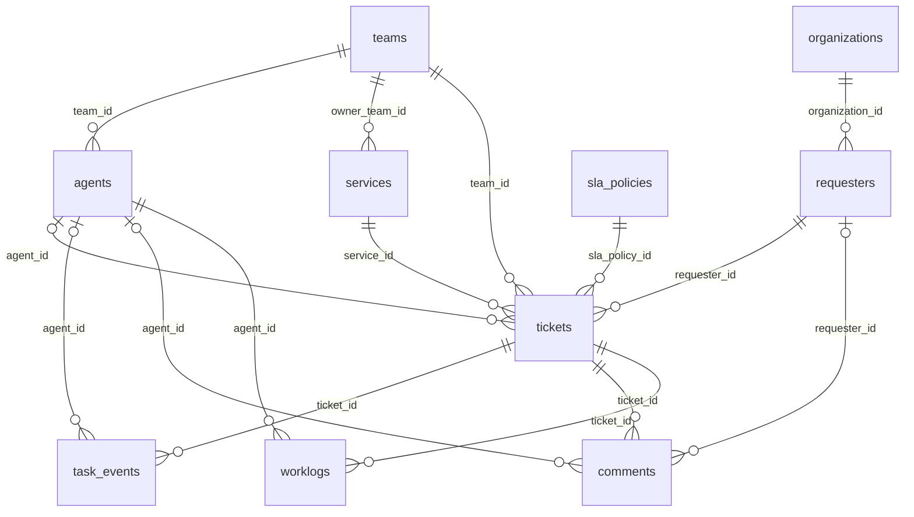

# Тестовые датасеты Pyrus и техподдержки

В приложении зарегистрированы **10 связанных PostgreSQL-датасетов**. Они моделируют техподдержку, организованную через задачи и формы Pyrus. Это полностью синтетические данные, а не выгрузка из аккаунта Pyrus. Идентификаторы задач, форм, пользователей и комментариев вымышлены. Адреса заявителей используют `example.invalid`.

Сущности задач, форм, ответственных и комментариев согласованы с понятиями [Pyrus Tasks API](https://pyrus.com/en/help/api/tasks) и [Members API](https://pyrus.com/en/help/api/members). Сервисы, тарифы и SLA — спроектированная для этого примера модель поддержки, а не обещание точного соответствия структуре API Pyrus.

Схема источника: `pyrus_support_demo`. Подключение приложения: `proxmox_postgres`. Снимок: **27 октября 2026, 00:00 UTC**; заявки создавались за предыдущие 180 дней. Генератор использует фиксированное зерно `20261027`.

| Датасет | Таблица | Строк | Одна строка |
|---|---|---:|---|
| Pyrus · Клиенты | organizations | 40 | Компания, её отрасль, регион и тариф |
| Pyrus · Заявители | requesters | 240 | Контакт клиента |
| Pyrus · Команды поддержки | teams | 4 | Команда и её специализация |
| Pyrus · Сотрудники поддержки | agents | 24 | Сотрудник, команда и стоимость часа |
| Pyrus · Сервисы | services | 8 | Поддерживаемый сервис или процесс |
| Pyrus · Правила SLA | sla_policies | 12 | Норматив тарифа и приоритета |
| Pyrus · Заявки | tickets | 3 000 | Заявка на дату снимка |
| Pyrus · История обработки | task_events | 15 319 | Событие обработки заявки |
| Pyrus · Комментарии и переписка | comments | 16 501 | Внешний или внутренний комментарий |
| Pyrus · Трудозатраты | worklogs | 8 953 | Запись времени и её стоимость |

Префикс slug всех датасетов — `pyrus_support_`. Датасеты имеют русские подписи колонок и реальные PostgreSQL-типы. В словаре зарегистрированы **24 показателя, 27 разрезов и 15 связей**. Источники не добавляются автоматически при старте: установка и регистрация выполняются явно.

## Связи



Клиент заявки находится через `tickets.requester_id → requesters.organization_id → organizations.id`. Показатели заявок считают на уровне `tickets.id`. Комментарии, события и трудозатраты — самостоятельные таблицы фактов: перед совместным JOIN их надо агрегировать по `ticket_id`, иначе строки и суммы размножатся.

## Правила показателей

- SLA работает **24/7 в календарных минутах**. Ожидание клиента не приостанавливает отсчёт. Дедлайны считаются от создания заявки.
- Первый ответ — первый внешний комментарий сотрудника. Внутренняя переписка не считается ответом клиенту.
- Время решения — от создания до окончательного решения после повторных открытий. Для нерешённых заявок `resolution_min` равно NULL.
- Флаг просрочки сравнивает дедлайн с фактическим ответом/решением, а при их отсутствии — с фиксированным снимком.
- Доля решённых в SLA считается только среди решённых заявок. В словаре она хранится как доля 0–1 с форматом `percent`.
- CSAT — оценка 1–5, только у части закрытых заявок. NULL означает, что оценки нет; это не нулевая оценка.
- Стоимость работы — `minutes / 60 × hourly_cost_rub`, с округлением до копеек на запись. Это внутренняя себестоимость, а не выручка.
- Месячная стоимость договора клиента не является доходом за каждый день или по каждой заявке.

Статусы: `new` — новая, `in_progress` — в работе, `waiting_customer` — ожидание клиента, `resolved` — решена, `closed` — закрыта. Приоритеты и тарифы записаны по-русски. Часть сотрудников неактивна на дату снимка. В последние 30 дней растёт поток обращений и время обработки у команды интеграций; есть просрочки, эскалации и повторные открытия.

## Вопросы для проверки аналитики

1. Как менялось число заявок по сервисам за последние шесть месяцев?
2. Какие команды чаще нарушают SLA ответа и решения?
3. Сколько нерешённых и просроченных заявок у каждой команды?
4. У каких сервисов больше повторных открытий и ниже CSAT?
5. Какие клиенты создают больше всего обращений и сколько стоит их обслуживание?
6. Как изменилось время первого ответа у команды интеграций в октябре?
7. Сравни загрузку сотрудников по часам и стоимости работы.
8. Какая доля переписки внутренняя, а какая видна клиенту?
9. Где большая доля эскалаций по приоритетам и каналам?
10. Какие заявки с критическим приоритетом ещё не решены и уже вышли за SLA?

## Воспроизведение

Из `backend/`:

```sh
.venv/bin/python -m app.datasets.pyrus_demo --output /tmp/pyrus-support-demo.sql
```

SQL создаёт новую схему и загружает все таблицы транзакцией. Существующая схема не перезаписывается и не очищается. Администратор источника применяет SQL в нужной PostgreSQL-базе и предоставляет роли существующего подключения `USAGE` на схему и `SELECT` на таблицы. Пароли и адреса в SQL не включаются.

Затем в окружении приложения:

```sh
python -m app.datasets.pyrus_demo --register --connection-key proxmox_postgres
```

Регистрация читает фактическую схему и комментарии, создаёт словарь и связи, проверяет выражения показателей на источнике. Повторная регистрация не заменяет существующие датасеты. В приложение не добавляется ни подключение, ни ключ Pyrus.
